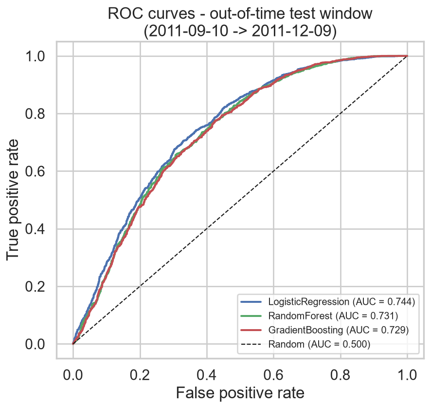
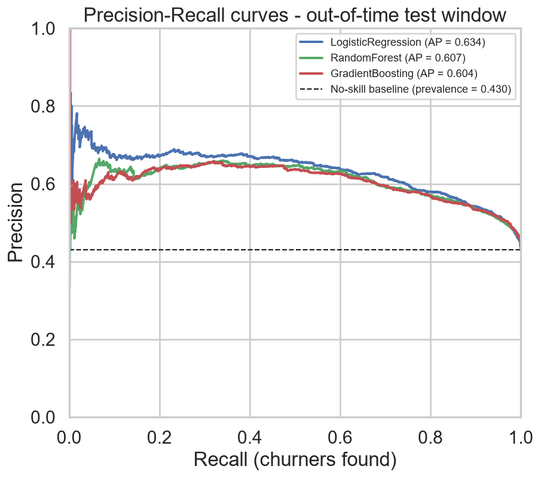
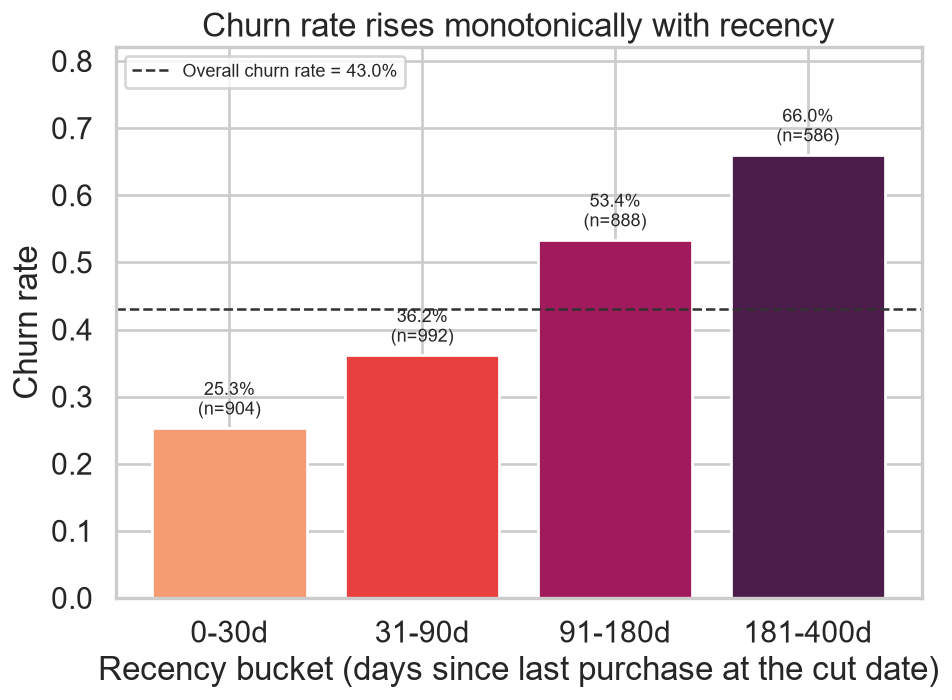
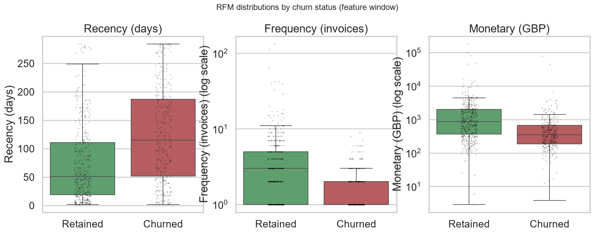
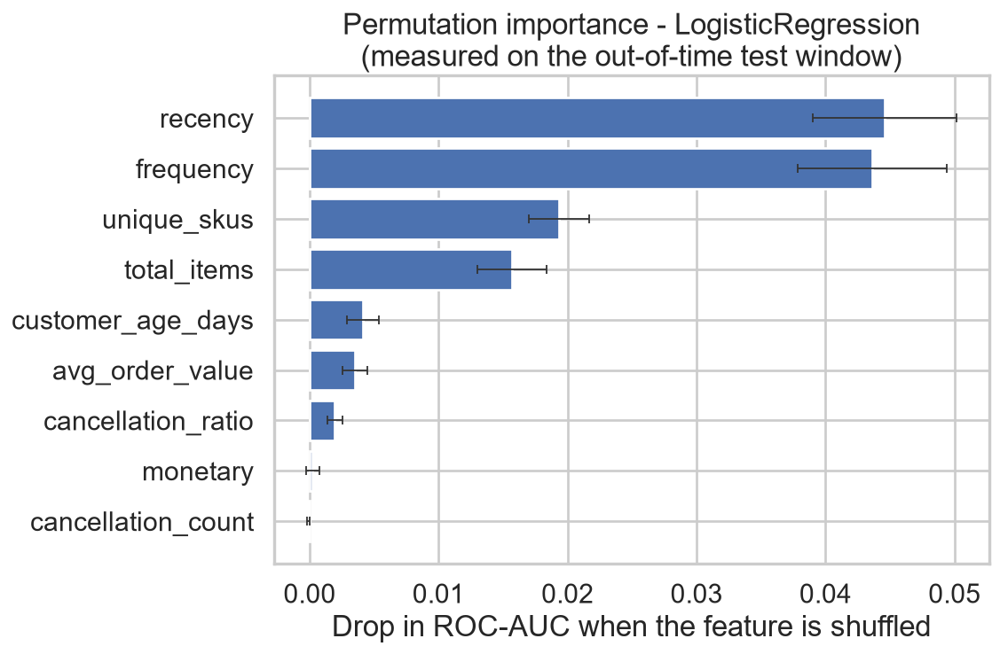
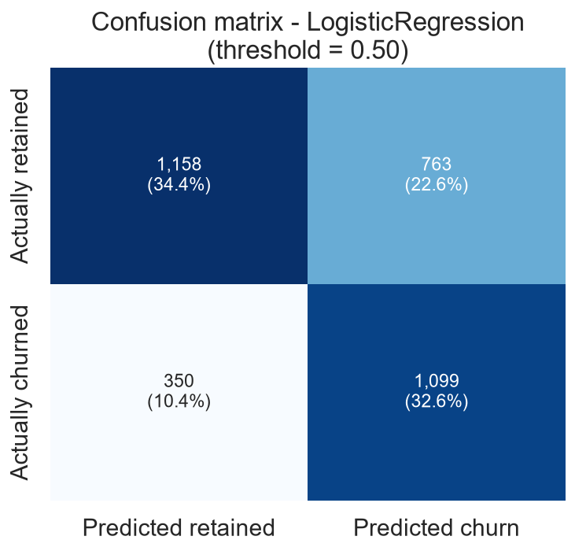

# Customer Churn Prediction — UCI Online Retail

An end-to-end churn project on ~542k real retail transactions: clean the data, define
churn honestly, engineer RFM features, train three models on a **time-based** split,
evaluate them out of time, and ship a CLI that scores new customers.

**Headline result:** churn is predicted out of time with **ROC-AUC 0.744** and
**PR-AUC 0.634**, versus a majority-class baseline accuracy of **0.570** that the best
model lifts to **0.670** — while catching **76%** of the customers who actually churned.

---

## 1. The business question

> *Which customers are about to stop buying, so we can spend retention budget on them
> before they are gone?*

For an online retailer, acquiring a customer costs far more than keeping one. If we can
flag the customers who are drifting away a quarter in advance, marketing can target a
discount, a reminder, or a personal outreach at that specific group instead of
discounting indiscriminately.

The concrete framing used here:

- Pick a **cut date**.
- Look at every customer who bought **at or before** the cut date.
- Ask: did that customer buy again in the **90 days after** the cut date?
- If not, they **churned**.

That is a supervised binary classification problem, and the model's job is to output a
churn probability per customer at the cut date.

---

## 2. Results at a glance

All metrics are from the **held-out test window** (2011-09-10 → 2011-12-09), which the
model never saw during training. Decision threshold = 0.50.

| Model | ROC-AUC | PR-AUC | Precision | Recall | F1 | Accuracy |
|---|---|---|---|---|---|---|
| **LogisticRegression** (best) | **0.7443** | **0.6342** | 0.5902 | 0.7585 | 0.6638 | 0.6697 |
| RandomForest | 0.7311 | 0.6070 | 0.5760 | 0.7764 | 0.6614 | 0.6582 |
| GradientBoosting | 0.7286 | 0.6043 | 0.5768 | 0.7778 | 0.6624 | 0.6591 |
| Majority-class baseline | 0.500 | 0.430 | – | – | – | 0.5700 |

Confusion matrix for the best model (LogisticRegression):

| | Predicted retained | Predicted churn |
|---|---:|---:|
| **Actually retained** | 1,158 | 763 |
| **Actually churned** | 350 | 1,099 |

In business terms: of 3,370 customers, **1,449 genuinely churned**. The model flags
1,862 customers as at risk and **1,099 of them really did churn** — it finds three
quarters of the churners, at the cost of 763 false alarms.





### The signal is real and monotone

Churn risk rises steeply with recency — the single most intuitive and most useful
relationship in the data:

| Recency bucket | Customers | Churned | Churn rate |
|---|---:|---:|---:|
| 0–30 days | 904 | 229 | **25.3%** |
| 31–90 days | 992 | 359 | **36.2%** |
| 91–180 days | 888 | 474 | **53.4%** |
| 181–400 days | 586 | 387 | **66.0%** |





---

## 3. The data

**Source:** [UCI Machine Learning Repository — Online Retail](https://archive.ics.uci.edu/dataset/352/online+retail) (ID 352).
Every transaction of a UK-based, registered, non-store online giftware retailer between
**2010-12-01 and 2011-12-09**.

| Fact | Value |
|---|---:|
| Raw rows | 541,909 |
| Cleaned rows | 392,692 |
| Unique customers | 4,338 |
| Total revenue | £8,887,208.89 |

Columns: `InvoiceNo, StockCode, Description, Quantity, InvoiceDate, UnitPrice, CustomerID, Country`.

A **437-customer sample** (`data/sample/online_retail_sample.csv`, 55,177 raw rows) is
committed so the pipeline runs with zero downloads. `run_all.py` prefers the full
workbook in `data/raw/` when it is present and otherwise falls back to the sample,
printing a clear warning about which source it used.

### Cleaning (applied in this exact order)

Each step is logged with the number of rows it removes — the pipeline prints this table
and writes it into `reports/model_report.md`:

| Step | Rows removed | Rows remaining |
|---|---:|---:|
| 1. drop rows with missing `CustomerID` | 135,080 | 406,829 |
| 2. drop cancellations (`InvoiceNo` starts with `'C'`) | 8,905 | 397,924 |
| 3. drop `Quantity <= 0` | 0 | 397,924 |
| 4. drop `UnitPrice <= 0` | 40 | 397,884 |
| 5. drop exact duplicate rows | 5,192 | 392,692 |
| 6. `revenue = Quantity * UnitPrice` | 0 | 392,692 |

Two details worth calling out:

- **Missing `CustomerID` is the single biggest loss** (135,080 rows, 25% of the data).
  Those are guest/unidentified checkouts. They cannot be attributed to a customer, so
  they cannot be labelled — but it is worth knowing that a quarter of revenue activity
  is invisible to a customer-level model.
- **Cancellations are removed from every monetary aggregate, but not thrown away.**
  Rule 2 removes them from the transaction table, yet the rows are retained separately
  and reused to build the `cancellation_count` and `cancellation_ratio` features. A
  customer who cancels orders behaves differently, and deleting that signal outright
  would be wasteful.

---

## 4. How to run

**Requirements:** Python 3.11. No `make`, no Docker, no database.

```bash
pip install -r requirements.txt

# Primary path — full dataset if present in data/raw/, otherwise the bundled sample
python run_all.py
```

That single command runs data → clean → windows → features → train → evaluate → figures
→ save model → write `reports/model_report.md`, and finishes by verifying that all six
figures exist and are non-empty.

Optional flags:

```bash
python run_all.py --sample      # force the bundled 437-customer sample
python run_all.py --download    # fetch the full UCI workbook into data/raw/ first
```

To use the full dataset:

```bash
python run_all.py --download    # ~23 MB, downloads and unzips Online Retail.xlsx
python run_all.py               # auto-detects it
```

### Scoring new customers

```bash
# Raw transactions (the eight Online Retail columns) — features are rebuilt for you
python predict.py --input data/sample/predict_example.csv

# Or a file that already contains the nine engineered features
python predict.py --input data/sample/predict_features_example.csv --threshold 0.4

# Write the scores out
python predict.py --input data/sample/online_retail_sample.csv --output reports/predictions.csv
```

Real output from the committed example file:

```
========================================================================
CHURN PREDICTION
========================================================================
model      : LogisticRegression
input      : data/sample/predict_example.csv  (583 rows)
cut date   : 2011-06-12   snapshot: 2011-06-13
threshold  : 0.50
input mode : raw transactions
customers  : 6
flagged    : 5 (83.3%) at threshold 0.50
------------------------------------------------------------------------
 CustomerID  churn_probability  prediction prediction_label risk_tier
      14813             0.7157           1            churn      HIGH
      17829             0.7149           1            churn      HIGH
      12426             0.6037           1            churn    MEDIUM
      14704             0.5725           1            churn    MEDIUM
      16113             0.5606           1            churn    MEDIUM
      15312             0.4544           0            retain    MEDIUM
========================================================================
```

`Makefile` is included as an **optional** convenience wrapper (`make run`) around the
same commands. Plain `python run_all.py` is the supported path.

---

## 5. Methodology

### 5.1 The time-based split — the most important decision here

**I never use `sklearn.model_selection.train_test_split` on this data.**

The label answers a question about *the future*: "did this customer buy again in the
next 90 days?" A random split therefore does something subtly fatal — it puts customers
observed at the **end** of 2011 into the training set and customers observed in
**mid-2011** into the test set. The model is then fitted on a later period than the one
it is scored on.

That is leakage in the temporal sense, and it is not hypothetical. Retail behaviour is
strongly seasonal: a November/December shopper buys giftware in bulk and then disappears
for a year, while a June shopper behaves nothing like that. A random split lets the
model memorise the seasonal shape of the *whole* year — including the part that is
"future" for the test rows — and the offline metrics come out flattering while the model
fails in production.

What I do instead is a **rolling-origin (out-of-time) backtest**:

| Window | Feature window | Label window | Customers | Churn rate |
|---|---|---|---:|---:|
| **Train** | ≤ 2011-06-12 | 2011-06-12 → 2011-09-10 | 2,821 | 52.3% |
| **Test** | ≤ 2011-09-10 | 2011-09-10 → 2011-12-09 | 3,370 | 43.0% |

Both windows are exactly 90 days long. The test period is **strictly later** than the
training period, so nothing the model is scored on could have influenced its fit. This
is precisely how the model would be deployed: fit on history, predict the next quarter.
The cost is that the test window is smaller and the train/test churn rates differ
(52.3% vs 43.0%) — a real, visible distribution shift that a random split would have
hidden.

### 5.2 Churn definition

- End of data: **2011-12-09**
- Feature window: transactions up to and including **2011-09-10** (= end − 90 days)
- Label window: **2011-09-10 → 2011-12-09** (90 days)
- **Churn = the customer has zero purchases in the label window**
- In scope: customers with **at least 1 purchase in the feature window**

| Quantity | Value |
|---|---:|
| Customers in scope | 3,370 |
| Churned | 1,449 |
| Retained | 1,921 |
| **Churn rate** | **43.0%** |
| Majority-class baseline accuracy | **0.570** |

That 0.570 baseline is the number to beat: a model that predicts "nobody churns" is
already 57% accurate. Accuracy alone is therefore a weak metric here, which is why
ROC-AUC and PR-AUC carry the weight.

### 5.3 Features

All nine features are computed **only** from the feature window, with
`snapshot = cut date + 1 day` as "today". Nothing after the cut date can reach the
feature matrix.

| Feature | Description |
|---|---|
| `recency` | Days between the customer's last purchase and the snapshot date (cut + 1 day). |
| `frequency` | Number of distinct invoices in the feature window. |
| `monetary` | Total revenue (`Quantity × UnitPrice`) in the feature window. |
| `avg_order_value` | `monetary / frequency`. |
| `total_items` | Total units purchased. |
| `unique_skus` | Number of distinct `StockCode`s purchased. |
| `customer_age_days` | Days between the customer's first purchase and the cut date. |
| `cancellation_count` | Distinct cancelled invoices before the cut. |
| `cancellation_ratio` | `cancellation_count / (cancellation_count + frequency)`. |

### 5.4 Models and class imbalance

Churn is 43% of the data — not rare, but still the minority class, so an unweighted
model is biased towards "retained". Every model is balanced **explicitly**:

| Model | Imbalance handling | Key hyperparameters |
|---|---|---|
| LogisticRegression | `class_weight='balanced'` | `StandardScaler` → `C=1.0`, `max_iter=2000`, `random_state=42` |
| RandomForest | `class_weight='balanced_subsample'` | `n_estimators=500`, `min_samples_leaf=5`, `random_state=42` |
| GradientBoosting | balanced **sample weights** via `compute_sample_weight('balanced', y)` — the class has no `class_weight` argument | `n_estimators=300`, `learning_rate=0.05`, `max_depth=3`, `subsample=0.9`, `random_state=42` |

Hyperparameters were fixed **before** looking at the test window. Nothing was tuned
against the test set, so these are genuine out-of-time estimates rather than an
optimistically selected best-of-many.

### 5.5 Metrics

ROC-AUC and PR-AUC are threshold-free and are the primary comparison. Precision, recall,
F1 and the confusion matrix are reported at a fixed 0.50 threshold for interpretability,
plus a best-F1 threshold sweep because 0.50 is arbitrary — with churn as the minority
class, lowering the threshold trades precision for recall:

| Model | Best-F1 threshold | F1 there | F1 at 0.50 |
|---|---:|---:|---:|
| LogisticRegression | 0.393 | 0.6800 | 0.6638 |
| RandomForest | 0.393 | 0.6751 | 0.6614 |
| GradientBoosting | 0.360 | 0.6753 | 0.6624 |

---

## 6. What the model learned



Permutation importance on the test window (drop in ROC-AUC when a feature is shuffled):

| Feature | Mean ROC-AUC drop |
|---|---:|
| `recency` | 0.0446 |
| `frequency` | 0.0436 |
| `unique_skus` | 0.0193 |
| `total_items` | 0.0157 |
| `customer_age_days` | 0.0041 |
| `avg_order_value` | 0.0035 |
| `cancellation_ratio` | 0.0020 |
| `monetary` | 0.0002 |
| `cancellation_count` | −0.0001 |



Three honest observations:

- **`recency` and `frequency` dominate; `monetary` is nearly redundant.** Once you know
  how recently and how often someone bought, *how much* they spent adds almost nothing.
  That is a common and useful finding — it means the model does not need revenue data to
  work, and a simpler `recency × frequency` segmentation captures most of the value.
- **`cancellation_count` is worthless here** (−0.0001, i.e. noise). Cancellation
  behaviour did not generalise from the training period to the test period.
- **LogisticRegression won.** With nine features, a strong monotone signal (recency), and
  only 2,821 training rows, a well-regularised linear model on scaled features is hard to
  beat — the tree ensembles spend their capacity approximating a smooth monotone function
  and pay a variance cost for it. This is a reminder that the fanciest model is not
  automatically the best, and it is exactly why the baseline is trained first.

---

## 7. Project structure

```
customer-churn-prediction/
├── run_all.py                  # full pipeline (primary entry point)
├── predict.py                  # CLI: score a CSV of customers
├── requirements.txt
├── Makefile                    # optional wrapper around `python run_all.py`
├── LICENSE                     # MIT
├── src/
│   ├── data.py                 # load, clean (6 logged rules), build churn windows
│   ├── features.py             # RFM + cancellation feature engineering
│   ├── train.py                # time-based split, three models, imbalance handling
│   └── evaluate.py             # metrics + the six figures
├── data/
│   ├── sample/
│   │   ├── online_retail_sample.csv        # 437-customer sample (committed)
│   │   ├── predict_example.csv             # demo input for predict.py
│   │   └── predict_features_example.csv    # demo input, engineered-features mode
│   └── raw/                    # full UCI workbook goes here (git-ignored)
├── models/
│   └── churn_model.joblib      # best model + metadata (committed)
└── reports/
    ├── model_report.md         # auto-generated, contains the real metrics
    ├── metrics.json            # machine-readable metrics
    ├── feature_importance.csv
    ├── churn_by_recency.csv
    └── figures/
        ├── roc_curves.png
        ├── pr_curve.png
        ├── confusion_matrix.png
        ├── feature_importance.png
        ├── churn_rate.png
        └── rfm_by_churn.png
```

`reports/model_report.md` is regenerated on every run and contains the same metrics plus
the full cleaning log and a sanity check against the known full-data reference figures.

---

## 8. Tech stack

| Layer | Tool |
|---|---|
| Language | Python 3.11 |
| Data | pandas 3.0.6, numpy 2.1.0 |
| Modelling | scikit-learn 1.9.1 |
| Metrics | scikit-learn (`roc_auc_score`, `average_precision_score`, `precision_recall_curve`, `permutation_importance`) |
| Statistics | scipy 1.17.1 |
| Plots | matplotlib 3.11.2, seaborn 0.13.2 |
| Persistence | joblib 1.6.0 |
| Excel I/O | openpyxl |

Deliberately dependency-light: no orchestration framework, no experiment tracker, no
database. The whole pipeline is three plain Python files plus a CLI, so it can be read
end to end in a few minutes.

---

## 9. Limitations and next steps

**Limitations**

1. **One test window.** The evaluation is a single 90-day out-of-time backtest. It is
   honest but noisy — a single window gives no confidence interval, and the train/test
   churn-rate gap (52.3% vs 43.0%) means the model is scored on a somewhat easier period
   than it was fitted on.
2. **No hyperparameter search.** Hyperparameters were fixed a priori to keep the test
   window untouched. They are defensible defaults, not tuned values.
3. **The saved model is trained on the training window, not on all data.** That is
   deliberate — it is exactly the model whose metrics are reported, so the numbers are
   reproducible from the artifact. A production deployment should refit on the full
   feature window (all 3,370 customers up to 2011-09-10); the pipeline supports this by
   changing one argument.
4. **25% of raw rows are dropped for a missing `CustomerID`.** Those guest checkouts are
   invisible to this model. If guest purchases correlate with churn, the model is blind
   to part of the picture.
5. **Churn is defined as "zero purchases",** which cannot distinguish a genuinely lost
   customer from someone on a long natural repurchase cycle. The 90-day window is a
   modelling choice, not a ground truth.
6. **No customer-level covariates** (country, tenure segment, product mix) are used
   beyond the nine engineered features. `Country` in particular is available and unused.
7. **No causal claim.** The model says who is *likely* to churn, not what would happen if
   we intervened. Targeting the highest-risk customers is not the same as targeting the
   customers whose behaviour we can actually change.
8. **`predict.py` rebuilds features from raw transactions using the model's stored cut
   date.** If you score a period far from that cut date, the feature semantics drift;
   pass `--cut-date` explicitly.

**Next steps**

1. **Nested time-series cross-validation.** Add a third window (cut 2011-03-14) so
   hyperparameters can be selected on an inner validation fold, refit on the training
   window, and scored once on the test window — leaving the test set genuinely untouched.
2. **Rolling-origin evaluation across several cut dates** to get a distribution of
   metrics rather than a single point estimate.
3. **Cost-sensitive threshold selection.** Replace the arbitrary 0.50 with the threshold
   that minimises expected cost, given the margin on a retained customer and the cost of
   a retention offer. The threshold sweep in the report is the starting point.
4. **Add `Country`, product-category mix, and inter-purchase-interval features** —
   the last one directly addresses limitation 5 by modelling each customer's own natural
   repurchase cycle.
5. **Calibrate the probabilities** (`CalibratedClassifierCV`) so that a predicted 0.7
   really means 70%, which matters if the score feeds a budget-allocation rule.
6. **Uplift modelling.** Move from "who will churn" to "who will respond to an
   intervention", which is the question the business actually cares about.
7. **Refit on all data and package the artifact** behind a small API with input
   validation and drift monitoring on the feature distributions.

---

## Data licence and attribution

The dataset is provided by the UCI Machine Learning Repository
([Online Retail, ID 352](https://archive.ics.uci.edu/dataset/352/online+retail)) and is
made available for research use. The code in this repository is released under the MIT
Licence — see [LICENSE](LICENSE).
